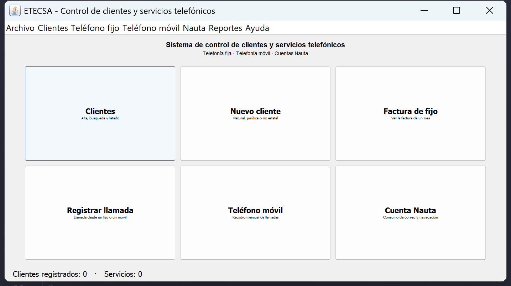
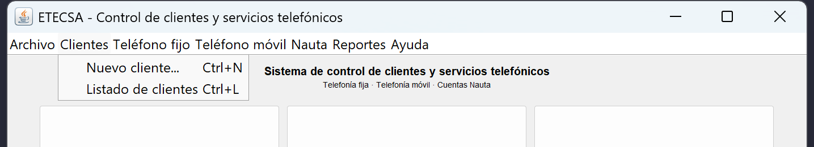
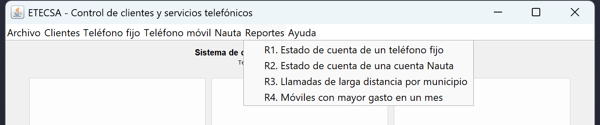
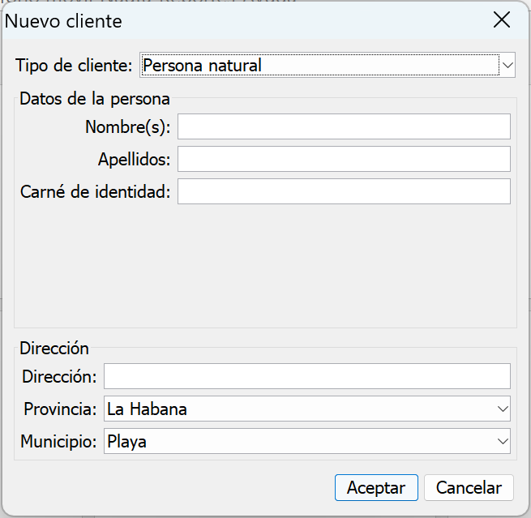
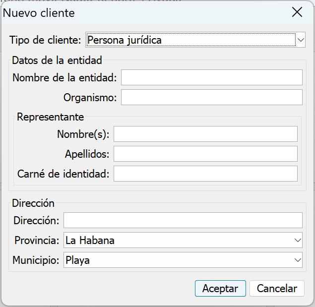
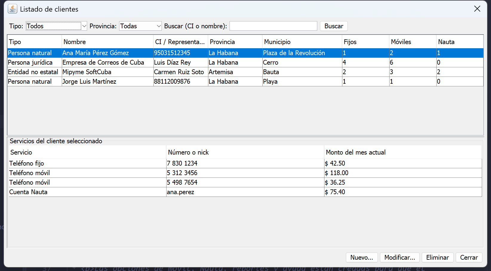
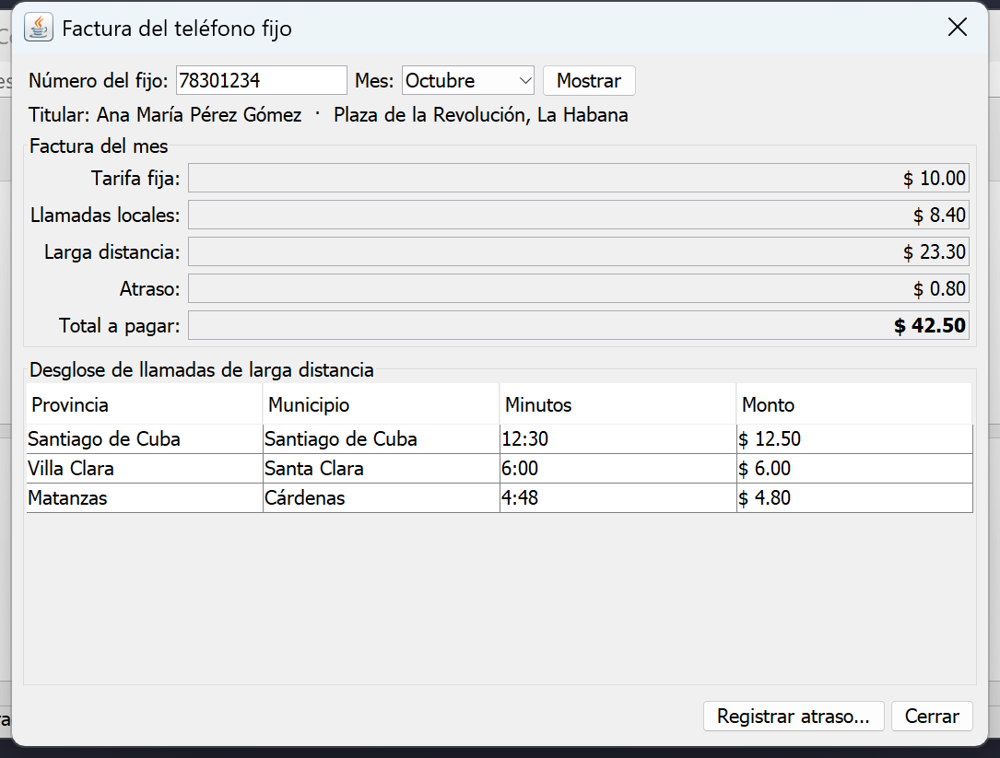
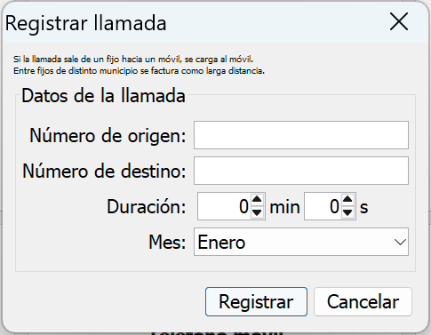

# Diseño de pantallas: principal, clientes y teléfono fijo

Corte 2 · Tarea 12 · Responsable: Inti · Participante: Carlos

Las pantallas están hechas en Swing, en el paquete `interfaz`, y ya se pueden abrir desde la ventana principal (`VentanaPrincipal.main`). En este corte solo tienen el diseño: los importes y las filas de las tablas son datos de ejemplo, y los botones que guardan datos muestran un aviso. En el Corte 3 cada botón llamará al método de `Etecsa` que se indica abajo, y los errores de validación se mostrarán con `JOptionPane`.

Todas las pantallas siguen las mismas reglas:

- La interfaz no crea objetos del modelo ni hace cálculos; solo llama a `Etecsa`.
- Etiquetas a la izquierda y campos a la derecha (clase `Formulario`), con los mismos márgenes en todos los diálogos.
- Botón de aceptar a la derecha y activado con Enter; Cancelar o Cerrar al lado.
- Provincia, municipio, mes y tipo de cliente se eligen de listas cerradas: el usuario no los escribe.
- Los diálogos son modales para que no queden dos formularios abiertos editando lo mismo.
- Los tamaños se ajustan a la letra del sistema, para que no queden apretados en pantallas con escalado alto.

## 1. Ventana principal

Clase: `interfaz.VentanaPrincipal`. Tiene **todos los menús** de la aplicación, para que después solo haya que conectar acciones (tarea 23) y nadie tenga que tocar la barra de menús a la vez:

| Menú | Opciones | Responsable |
| --- | --- | --- |
| Archivo | Salir (Ctrl+Q) | Inti |
| Clientes | Nuevo cliente (Ctrl+N), Listado de clientes (Ctrl+L) | Inti |
| Teléfono fijo | Asignar teléfono fijo, Factura del mes, Registrar llamada | Inti (asignar: Carlos) |
| Teléfono móvil | Asignar teléfono móvil, Registro del mes | Carlos |
| Nauta | Crear cuenta Nauta, Registrar consumo del mes, Consumo del mes | Carlos |
| Reportes | R1, R2, R3, R4 | R1 y R3 Inti; R2 y R4 Carlos |
| Ayuda | Ayuda (F1), Créditos | Carlos |

En el centro hay seis botones de acceso rápido a las tareas más frecuentes y abajo una barra de estado con la cantidad de clientes y servicios.

## 2. Registro de cliente

 

Clase: `interfaz.clientes.DialogoCliente`. Funcionalidades F01, F02, F03 y F04.

- El combo **Tipo de cliente** cambia la parte central (con `CardLayout`), sin abrir otra ventana:
  - Persona natural: nombre(s), apellidos y carné de identidad.
  - Persona jurídica: nombre de la entidad, organismo y representante.
  - Entidad no estatal: nombre y representante.
- El bloque **Representante** es el mismo en los dos tipos que lo tienen.
- **Dirección**, provincia y municipio son comunes. Al cambiar la provincia se cargan sus municipios.
- Validaciones previstas (las hace la capa lógica): CI de 11 dígitos con fecha válida, nombres sin dígitos y campos obligatorios no vacíos.
- Corte 3: Aceptar llama a `Etecsa.agregarCliente(...)` (o a `modificarCliente(...)` si se abrió desde Modificar).

## 3. Listado de clientes

Clase: `interfaz.clientes.VentanaListadoClientes`. Funcionalidades F05, F06, F07 y F08.

- Filtros por tipo de cliente y provincia, y búsqueda por CI o por nombre.
- La tabla de clientes muestra la cantidad de fijos, móviles y cuentas Nauta, así se ve de un vistazo si llegó a su límite.
- Al seleccionar un cliente, la tabla de abajo muestra sus servicios con el monto del mes actual.
- Botones Nuevo, Modificar y Eliminar. Eliminar pide confirmación, porque también borra los servicios del cliente (composición `Cliente` – `Servicio`).
- Corte 3: Eliminar llama a `Etecsa.eliminarCliente(id)` y Buscar a `buscarCliente(...)`. Para llenar la tabla y filtrarla hace falta un método que hoy no está en el diagrama, por ejemplo `listarClientes(tipo, provincia): ArrayList<Cliente>`; hay que añadirlo a `Etecsa`.

## 4. Factura del teléfono fijo

Clase: `interfaz.fijo.DialogoFacturaFijo`. Funcionalidades F12 y F13.

- Se escribe el número del fijo y se elige el mes; se muestra el titular.
- Bloque de la factura: tarifa fija, llamadas locales, larga distancia, atraso y total a pagar (en negrita). Los campos son de solo lectura.
- Debajo, el **desglose de larga distancia** con provincia, municipio, minutos y monto de cada llamada.
- **Registrar atraso** pide lo que quedó sin pagar del mes anterior.
- Corte 3: Mostrar llama a `Etecsa.buscarServicio(numero)` y a `TelefonoFijo.getFactura(mes)`; el atraso se guarda con `FacturaFijo.setAtraso(...)`.

## 5. Registrar llamada

Clase: `interfaz.fijo.DialogoRegistrarLlamada`. Funcionalidades F14 y F15.

- Número de origen, número de destino, duración (minutos y segundos) y mes.
- La nota de arriba recuerda la regla del enunciado: si la llamada sale de un fijo hacia un móvil, se carga al móvil.
- Corte 3: Registrar llama a `Etecsa.registrarLlamada(origen, destino, segundos, mes)`. La capa lógica decide si la llamada es local, de larga distancia o se carga a un móvil.

## Cómo regenerar las capturas

Abrir el proyecto en Eclipse y ejecutar `VentanaPrincipal` como Java Application. Las capturas de esta carpeta se tomaron en Windows 11 con el aspecto del sistema (`UIManager.getSystemLookAndFeelClassName()`).
